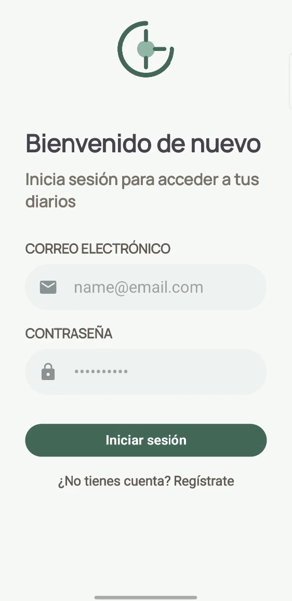
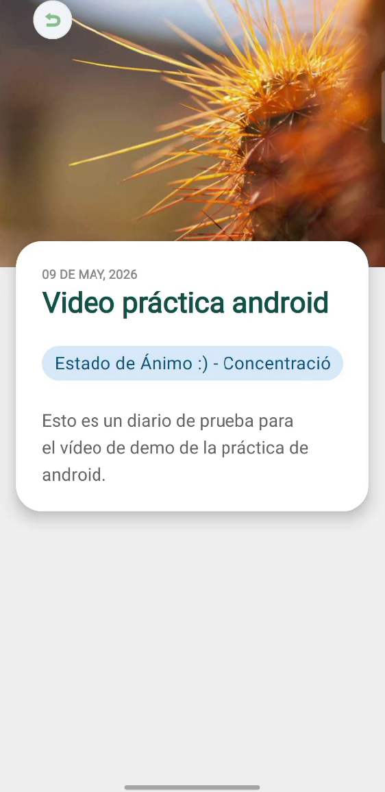
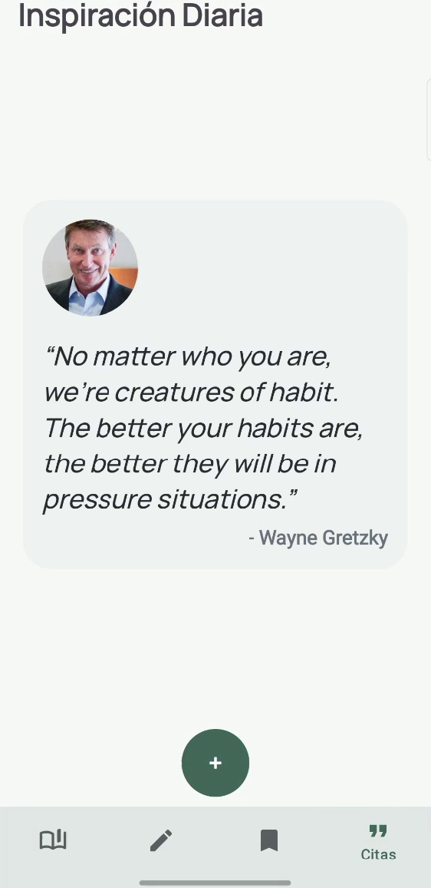

# Android Journal & Quotes

An Android app for writing a daily journal, recording a mood and keeping favourite entries close by. A separate tab fetches inspirational quotes and author images. Built in Kotlin for the Mobile Application Development course at U-tad.

<p>
  
  
  
</p>

## Features

- Email and password registration and sign-in with Firebase Authentication.
- Journal entries with a title, text, mood, timestamp and an image in the detail view.
- A timeline backed by Firebase Realtime Database listeners.
- Favourite entries stored under each user's account.
- Quotes from ZenQuotes, with author images from Wikipedia and a Picsum fallback.

## Project structure

The app uses Activities for authentication, Fragments and the Navigation component for its four tabs, RecyclerView adapters, XML layouts and View Binding. Firebase stores each user's entries under `users/{uid}/journals` and favourites under `users/{uid}/bookmarks`.

[Database example](firebase/user.demo.json)

## Configure your Firebase project

1. Register an Android app with package name `com.example.practicaandroid` in your Firebase project.
2. Enable email/password authentication and create a Realtime Database.
3. Download your project's `google-services.json` to `app/google-services.json`. [Configuration example](app/google-services.example.json)
4. Restrict database access to the authenticated user's node. [Database rules](firebase/database.rules.json)

## Build

Use Android Studio with JDK 21 and Android SDK 36.1.

```bash
./gradlew :app:assembleDebug
```

On Windows, run `gradlew.bat :app:assembleDebug`. The minimum Android version is API 28. Firebase and the quote/image APIs require a network connection.
